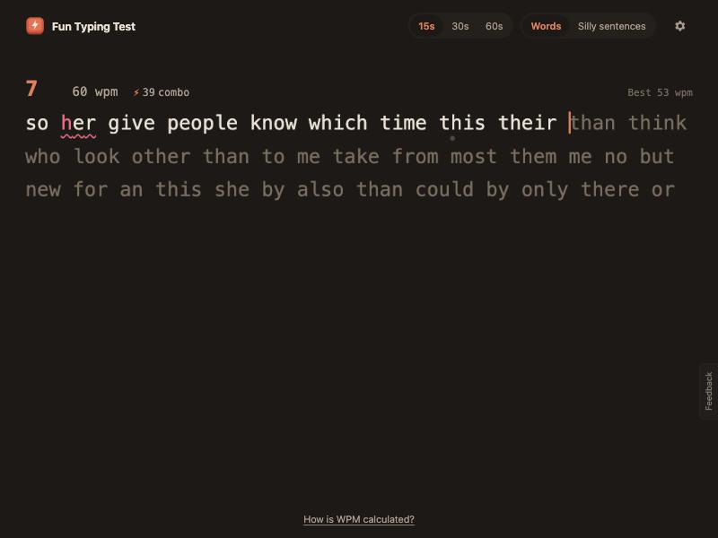
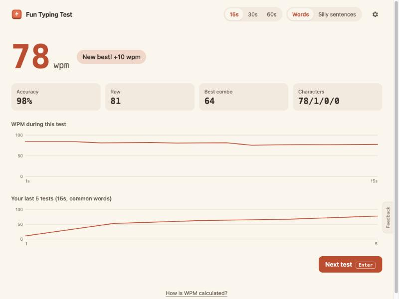
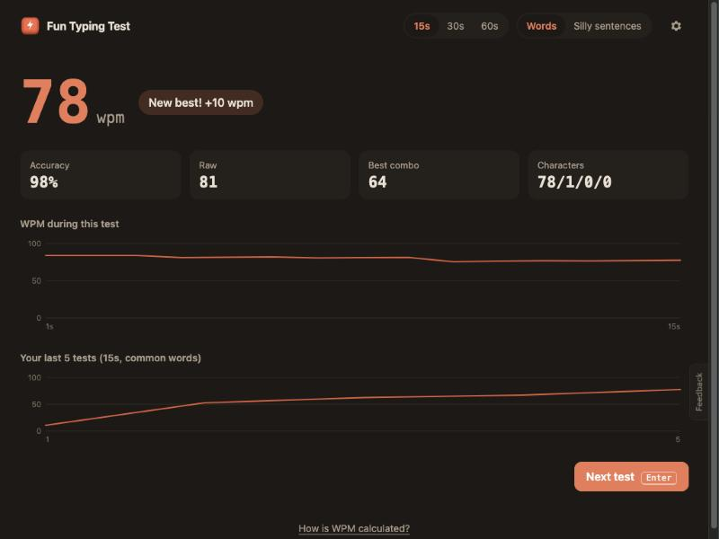
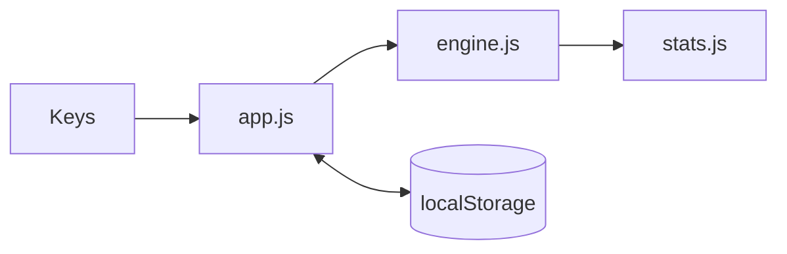

# Fun Typing Test

A calm, genuinely fun solo typing speed test: type, see your WPM, beat your best.

**[Play it →](https://amalmehta.github.io/FunTypingTest/)**

| Results (light) | Results (dark) |
|---|---|
|  |  |

Screenshots show demo runs typed by a test script, not a real person.

- [Play it online](https://amalmehta.github.io/FunTypingTest/)
- [How to run and use it](docs/INSTRUCTIONS.md)
- [System design and how WPM is calculated](docs/SYSTEM-DESIGN.md)
- [What's where](docs/FILE-STRUCTURE.md)
- [Manual review checklist](docs/MANUAL-REVIEW.md)
