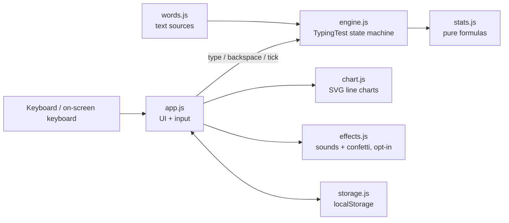

# System Design

Fun Typing Test is a static website: plain HTML, CSS and JavaScript modules, no build step, no backend, no dependencies. Everything runs in the browser and is saved in `localStorage`. It is hosted free on GitHub Pages from the `main` branch: https://amalmehta.github.io/FunTypingTest/

## Architecture

| Component | Job | Talks to |
|---|---|---|
| `js/app.js` | Reads keys, paints only the words that changed, moves the caret and ghost, runs the frame loop, shows results, wires settings and feedback dialogs | everything |
| `js/engine.js` | `TypingTest`: holds target words, what was typed, the clock, keystroke counts, combo, per-second samples. No DOM, so it is unit-tested in Node | `stats.js` |
| `js/stats.js` | Pure functions: character counts, gross and net WPM, accuracy, pacer position | — |
| `js/words.js` | Endless word streams: common words (cited) and silly sentences (original) | — |
| `js/storage.js` | Settings, run history (last 500), personal bests per mode, saved feedback. Each run stores date, mode, net and raw WPM and accuracy, plus `pb: true` when it beat a best. Runs are written at once; setting changes are batched 300 ms and flushed on page hide. Every read and write is in `try/catch`, so with storage blocked or full the app keeps working from memory for that visit | `localStorage` |
| `js/chart.js` | Single-series SVG line chart with hover crosshair + tooltip; axis-free sparkline for the history panel | — |
| `js/effects.js` | Web Audio key ticks and canvas confetti, both off by default and confetti respects reduced motion | — |

## Main flows

1. **Start.** The page loads, applies the saved theme before first paint (inline script in `index.html`), builds the first 60 words, and puts the caret on the first letter. Nothing is timed yet.
2. **Type.** Each `keydown` goes to `TypingTest.type()` or `.backspace()`. The engine starts the clock on the first letter. The UI repaints only the current word (and the previous one when a word is committed or reopened), then moves the caret with a CSS transform. The engine keeps at least 60 words ahead; new ones are appended to the DOM in one fragment.
3. **Frame loop.** While running, `requestAnimationFrame` calls `tick()`, which records one sample per whole second and ends the test at exactly the chosen duration. The timer text changes once a second, live WPM every 500 ms, the ghost every 250 ms.
4. **Results.** For 500 ms after results appear, Enter alone is ignored and stray letters are swallowed, so keys still in flight can't skip them. Tab alone no longer restarts a finished test; Tab then Enter within 1 s restarts at once. Esc toggles between the results and the finished text (the `reviewing` class hides the caret) without recomputing anything. The run is saved, the previous best is compared, the badge shows "New PB! +N wpm" or the gap, and both charts render on the next frame (they need the layout to measure width). A new PB turns the badge solid, pulses a soft ring twice and throws ten CSS sparks; with reduced motion only the badge shows. Full-screen confetti stays opt-in.
5. **History.** The clock button in the top bar (or History on the results, or Settings > Data) opens the last 20 runs across all modes, newest first, with a sparkline of net WPM (oldest to newest, best-beating runs dotted). "Clear history" asks inline before deleting runs and bests.

## Definitions (how the numbers are computed)

A “word” is 5 characters including spaces ([Wikipedia: Words per minute](https://en.wikipedia.org/wiki/Words_per_minute)). Gross WPM, net WPM and accuracy follow the standard definitions; they live as pure functions in `js/stats.js`.

$$\text{Gross} = \frac{C_t / 5}{m}$$

- $C_t$ — all characters in what was typed, right or wrong, including spaces
- $m$ — minutes since the first keystroke (the test duration at the end); page load does not start the clock

$$\text{Net} = \max\left(0,\ \text{Gross} - \frac{E}{m}\right)$$

- $E$ — uncorrected errors: wrong, extra and skipped letters still in the text

Net WPM is the headline number and the personal best. Fixed mistakes cost only the time spent fixing them.

$$\text{Accuracy} = \frac{K_c}{K_t} \times 100\%$$

- $K_c$ — correct keystrokes; a space is correct when the word before it is exactly right
- $K_t$ — all keystrokes except Backspace, so mistakes later fixed with Backspace still count against accuracy
- With no keystrokes, accuracy is 0 and both WPMs are 0 (no division by zero)

Other rules:

- **Combo**: consecutive correct keystrokes; any incorrect keystroke resets it. Shown from 10 upward; pulses every 25.
- **Personal best**: highest WPM per mode (text source × duration), only if above 0.
- **Ghost pacer**: a dot at character position $\lfloor \text{PB} \cdot 5 \cdot t / 60 \rfloor$, i.e. your best run assumed to be typed at an even pace (an assumption).
- **Backspace** returns to the previous word only if it has a mistake. `⌥⌫`/`Ctrl⌫` clears a word. Up to 10 extra letters per word are accepted.

## Key decisions and trade-offs

| Decision | Why | Trade-off |
|---|---|---|
| Static site, no framework, no build | Smallest thing that holds; instant load; nothing to update | Hand-written DOM code in `app.js` |
| `localStorage` only | One person, one browser (the stated audience); private by default | No sync across devices; clearing site data loses history |
| Engine separated from DOM | Scoring is the behavior that matters, so it is unit-tested without a browser | Two places to touch when adding a rule |
| Repaint only touched words; caret moves by `transform` | Keystrokes stay ~1–2 ms (measured), no layout thrash | Slightly more bookkeeping |
| Native MathML for the formula dialog | No KaTeX download, works offline, renders in all current browsers | Slightly plainer typography than KaTeX |
| Feedback saved locally + copy + `mailto:` draft with no recipient | No backend, nothing leaves the browser unless the user sends it | Feedback doesn't reach the maker automatically |
| Calm by default (sounds, confetti off) | User asked for calm with optional juice | The fun has to come from the results screen and records |
| `keydown`-based input | Precise, simple, works on desktop and iOS | Android keyboards report key code 229, so typing there is unreliable (deferred) |

## Testing

- `npm test` runs `node --test` over `tests/`: scoring formulas, clock start/stop, combo, backspace rules, extra-letter cap, word supply, word streams, and storage (bests per mode, PB flag, recent order, clearing; Node has no `localStorage`, so this also covers the in-memory fallback).
- Manual: [MANUAL-REVIEW.md](MANUAL-REVIEW.md) covers feel, smoothness, dark mode and devices.
- `npm run profile -- <wpm>` types a 15s test in headless Chrome with trusted key events and reports frame times, key-to-frame latency, caret lag, long tasks and layout shift. Results on 2026-10-23 (Chrome 156, MacBook):

  | Speed | Frame p99 / max | Key → next frame, max | Caret lag p95 / max | Long tasks | Layout shift |
  |---|---|---|---|---|---|
  | 80 WPM | 16.8 / 16.8 ms | 15.3 ms | 17 / 17 px | 0 | 0 |
  | 150 WPM | 16.8 / 16.8 ms | 16.2 ms | 16.9 / 22.6 px | 0 | 0 |

  17 px is about one letter. Profiling found and fixed two bugs: the caret swept back across the whole line when wrapping (now it jumps to the new line), and keys still in flight when time ran out could press "Next test" and skip the results (keys are now swallowed on the results screen, and Enter/Tab wait 500 ms).

## Scale and what would change

Today: one person, one browser, a few hundred runs. Storage is a single JSON blob under 100 KB (500 runs cap).

- **Sync across devices / accounts**: replace `storage.js` with an API-backed module (same interface: `settings`, `addRun`, `runs`, `best`). Needs auth and a small database; only worth it if people ask for it.
- **Public leaderboards**: needs a server, anti-cheat (bots can dispatch key events, as the tests here do), and moderation. Not planned.
- **Thousands of runs**: the history filter is a linear scan; move to IndexedDB with an index on mode if the cap is raised past ~10,000.

## Known limits

- Android on-screen keyboards: unreliable key detection (see above).
- Browser shortcuts: some browsers keep `⌘,` for their own settings; the gear button always works.
- The caret glides with a 90 ms transition, so it trails by up to about one letter at 150 WPM (measured). Turn off "Smooth caret" in Settings for an instant caret.
- Stats are per browser; private windows don't keep them.
